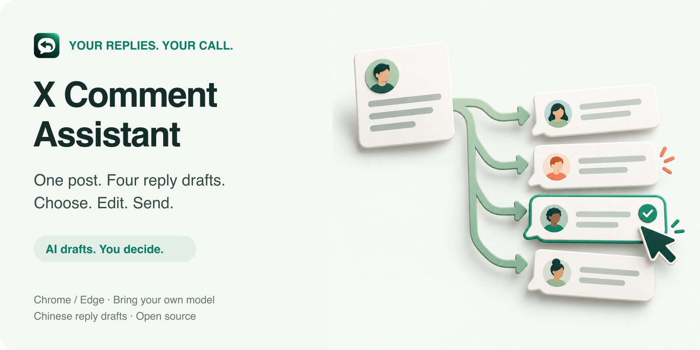

# X Comment Assistant

<p align="center"><a href="README.md">简体中文</a> · <a href="README.en.md">English</a></p>

<p align="center"></p>

<p align="center">在 X 回复框旁，一次生成四条中文草稿，由你挑选、编辑和发送。</p>

<p align="center"><sub>工作流程概念插图；实际功能以使用说明为准。</sub></p>

<p align="center"><a href="https://github.com/captainyufei/x-comment-assistant/releases/latest/download/x-comment-assistant.zip">下载浏览器安装包</a> · <a href="docs/USAGE.md">使用教程</a> · <a href="docs/LOCAL_AGENT.md">可选本地 Agent</a></p>

## 开始使用

**0.13.0 起，普通用户使用 API 只需要浏览器扩展。无需 Node.js、终端、本机桥接、扩展 ID 或配对。**

### 1. 下载并加载

1. [下载 `x-comment-assistant.zip`](https://github.com/captainyufei/x-comment-assistant/releases/latest/download/x-comment-assistant.zip)，解压到长期保留的文件夹。
2. 打开 Chrome 的 `chrome://extensions` 或 Edge 的 `edge://extensions`，开启「开发者模式」。
3. 点「加载已解压的扩展」，选择解压后的 **`XCommentAssistant` 文件夹**。这个文件夹内直接有 `manifest.json`。
4. 从工具栏拼图菜单找到「X Comment Assistant」，可将图标固定到工具栏。

请下载上面的发行安装包。仓库的 **Code → Download ZIP** 是开发源码，目录结构不同。

### 2. 配置自己的模型

打开插件 →「模型设置」→「模型 API」：

1. 选择服务商，填写自己的 API Key。
2. 点击输入框外，或点「刷新列表」，选择一个可用模型。
3. 不支持读取列表的服务商，可选「手动填写模型名称…」，填写控制台提供的型号或接入点 ID。
4. 点「保存配置」。首页显示「模型已配置，生成时验证」，表示配置已保存，实际权限和余额在生成时确认。

### 3. 在 X 中回复

刷新 X 页面 → 从原帖点「回复」→ 点本插件的「生成四条回复」→ 挑一条填入或复制 → 修改后自行发送。

**打开回复框不会自动生成，插件也不会自动发送评论。** 原生回复框已有草稿时，会询问替换或追加。

详细步骤、更新和卸载见 [使用教程](docs/USAGE.md)。

## 回复风格

八种风格：日常聊天、轻松有梗、理性专业、犀利克制、认可共鸣、换个角度、实用建议、温和共情。

- **自动匹配**：按原帖语境为四条候选选择合适风格，卡片显示实际风格。
- **手动选择**：生成同一风格的四条不同回复。
- 修改风格下次生成生效；点击「换一组」才会再次调用模型。

在一次模型请求中完成理解和写作，没有额外增加一轮话题分类请求。玩梗、反讽、事实与情绪判断仍可能出错，发送前请审阅。

## 支持哪些模型

| 来源 | 当前接入 | 是否需要额外桥接 |
| --- | --- | --- |
| 模型 API | DeepSeek、OpenAI、千问、Kimi、MiniMax、豆包／火山方舟 | 不需要，浏览器直接调用 |
| 本地模型 | Ollama、LM Studio 的本机 OpenAI 兼容服务 | 不需要；需事先加载模型并启动该服务 |
| 本地 Agent | Codex、Claude Code | 需要可选本机桥接，见 [安装说明](docs/LOCAL_AGENT.md) |

DeepSeek、OpenAI、千问、Kimi及本地兼容服务支持读取模型列表；云服务通常需要先填对应 Key。MiniMax、豆包目前需手动填写模型名或接入点 ID。列表可见不等于有调用权限、余额或视觉能力。

云 API 使用各服务商自己的账户和计费。本地 Agent 也可能调用云模型；Gemini CLI 当前未启用。

## 图片、视频与准确性

- 读取当前回复对应的原帖文字、引用和可获得的媒体，不采集完整账户历史，不读取 X 密码或 cookies。
- 只有明确适配视觉能力的具体型号才会读取受限的公开图片；其他型号依据文字和替代文字生成。
- **视频目前最多读取封面**，不读取连续画面、声音或字幕，不能据此理解完整剧情。
- 没有实时联网检索；缺少关键画面或前文时会提示缺口。格式校验不能证明事实和语义正确。

## 密钥保存

浏览器直连模式的 Key 按服务商独立加密，保存在当前浏览器资料中：

- 使用 **AES-256-GCM**；密文在 `chrome.storage.local`，不可导出的加密密钥在扩展自己的 IndexedDB。
- 不通过浏览器同步，不回填到设置框，不向 X 页面或内容脚本提供 Key。
- 留空沿用同一服务商已有的 Key，填写新值则替换。模型请求直接发给选定服务商，使用该服务商的认证。
- 这不是 macOS 钥匙串或 Windows 系统凭据库，不能保证抵御已被控制的浏览器、扩展代码或用户资料。

更换浏览器、设备，或清除扩展数据后需重新填写。旧版桥接的 Key 不会自动复制到浏览器；升级用户可保留桥接方式，或切换后另填一次。详见 [安全说明](SECURITY.md) 与 [升级说明](docs/USAGE.md#从旧版升级)。

## 常见问题

| 现象 | 处理方式 |
| --- | --- |
| 首页显示「尚未配置模型」 | 在模型设置中填写自己的 Key、选择模型并保存 |
| 模型列表为空 | 检查 Key、网络和官方服务地址；也可手动填写型号 |
| 提示权限、余额或限流错误 | 检查对应服务商账户；插件不自动充值或切换模型 |
| 本地模型连不上 | 先在 Ollama／LM Studio 加载模型并开启本机 API 服务 |
| 升级后仍显示本机服务未连接 | 旧版桥接模式会保留；在模型设置底部「高级：连接方式」切到浏览器直连，再填自己的 Key |
| 页面没出现新按钮 | 在扩展页重新加载本插件，然后刷新 X；从原帖进入回复框 |
| 候选未填入 | 检查替换确认，或点击「复制」后手动粘贴 |

当前尚未上架扩展商店，使用解压加载方式。Chrome／Edge 共用同一个安装 ZIP；主要实测环境是 macOS，**Windows 实机验收尚未完成**，不要将离线测试视为跨平台保证。

## 开发与贡献

普通用户无需构建，也无需安装 npm 依赖。开发者使用源码：

```sh
git clone https://github.com/captainyufei/x-comment-assistant.git
cd x-comment-assistant
npm ci --ignore-scripts
npm test
npm run check:public
```

开发需要 Node.js 20+。加载源码中的 `extension/` 目录即可调试浏览器直连功能；需要本机 Agent 时再按 [可选桥接说明](docs/LOCAL_AGENT.md) 启动服务。

- `extension/`：Manifest V3 扩展、小窗、页面接入和浏览器 API 引擎。
- `bridge.mjs`、`*-runner.mjs`：可选本机桥接及 Agent 适配。
- `*.test.mjs`、`fixtures/`：离线测试和合成页面。
- [CONTRIBUTING.md](CONTRIBUTING.md)：贡献约定；[CHANGELOG.md](CHANGELOG.md)：更新记录。

CI 不使用真实模型密钥，不发送 X 评论。公开源码不包含个人账户历史、真实试评、密钥或私有截图。

## 许可证

使用 [MIT License](LICENSE)。模型服务、CLI 与 X 的账户、计费和使用条款由各自服务商管理。
