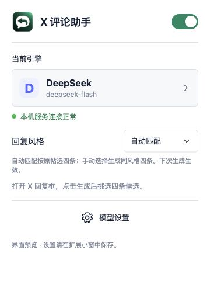

# X 评论助手

<p align="center"></p>

<p align="center">人工挑选的中文回复草稿 · 自选模型 · 本机保存密钥</p>

<p align="center"><a href="#开始使用">安装与使用</a> · <a href="docs/USAGE.md">详细教程与更新卸载</a> · <a href="SECURITY.md">安全说明</a></p>

在 X 的原帖回复框旁，按需生成四条中文回复草稿。挑一条、改一改，再由你点击发送。

插件只在点击「生成四条回复」或「换一组」后调用模型；打开回复框不会自动生成，也不会自动发评论。

## 能做什么

- 一次生成四条候选，可填入原生回复框或单独复制。
- 八种回复风格：日常聊天、轻松有梗、理性专业、犀利克制、认可共鸣、换个角度、实用建议、温和共情。
- 自动匹配按原帖语境为每条候选选择风格；手动选择则返回同一风格的四条不同回复。卡片显示实际风格，设置下次生成生效。
- 小弹窗管理模型与启停，无需常驻侧栏。
- 使用你自己的云 API、本机 Agent 或本机模型服务。

没有单独增加一轮话题分类请求。模型在同一次生成中理解原帖并选择回复方式；识别玩梗、反讽和情绪表达仍可能出错，需要审阅。

## 模型来源

| 来源 | 当前接入 | 配置方式 |
| --- | --- | --- |
| 模型 API | DeepSeek、OpenAI、千问、Kimi、MiniMax、豆包／火山方舟 | 选择服务商，填写自己的 API Key 和可用模型 |
| 本地 Agent | Codex、Claude Code | 事先安装并在自己的终端完成登录；插件复用 CLI 配置 |
| 本地模型 | Ollama、LM Studio | 事先启动本机 OpenAI 兼容服务并加载模型，填写本机 `/v1` 地址 |

DeepSeek、OpenAI、千问、Kimi 及本地兼容服务支持读取模型列表；云服务通常需要先填写对应 Key。MiniMax、豆包目前手动填写模型名或接入点 ID。列表可见不等于有生成权限、余额或视觉能力。

Gemini CLI 暂未启用。云 API 使用各服务商自己的账户与计费；本地 Agent 也可能调用云模型。本地安装 Agent 不代表离线推理。

## 开始使用

需要 **Node.js 20+**、Chrome 或 Edge，以及已登录的 X 网页。建议从 [Node.js 官网](https://nodejs.org/en/download) 安装当前 LTS（22 或 24）；最低兼容版本不是推荐长期使用的版本。只使用 API 时，不必安装 Codex、Claude Code 或本地模型。

### 0. 下载并进入项目目录

**不熟悉 Git：** 点击仓库右上方 **Code → Download ZIP**，解压到打算长期保留的文件夹。在其中找到同时含有 `package.json`、`bridge.mjs` 和 `extension/` 的目录，打开终端／PowerShell 并进入这个目录。

**使用 Git：**

```sh
git clone https://github.com/captainyufei/x-comment-assistant.git
cd x-comment-assistant
```

确认 Node 已安装：

```sh
node --version
```

后续命令均在这个项目目录运行。运行服务不需要安装 npm 依赖；`npm ci` 只用于开发测试。下载或 Git 克隆只是取得代码，还需要下面的浏览器扩展和本机服务两部分。

### 1. 加载扩展

打开 `chrome://extensions` 或 `edge://extensions`，开启开发者模式，选择「加载已解压的扩展」，加载项目的 `extension/` 文件夹。

复制扩展卡片显示的 **32 位扩展 ID**。ID 不是 API Key；不同电脑、浏览器或加载路径可能不同。先选一个浏览器使用：当前一个桥接只信任一个扩展 ID，Chrome 与 Edge 不能直接共用不同 ID。

### 2. 启动本机桥接

**macOS**：先明确配置本机扩展 ID（替换引号中的占位文字）：

```sh
node configure-extension.mjs --extension-id "替换为扩展管理页的32位ID"
```

命令只在本机生成已被 Git 忽略的 `extension-trust.json`，不写入 API Key，不会信任首个来访插件。相同 ID 无需重写；主动更换扩展 ID 时才加 `--replace`。

先在终端运行：

```sh
npm start
```

保留该终端，打开插件「模型设置」完成下一步。首次显示模型未就绪时，可继续配置 API 或本地模型，不必先安装 Codex。

**Windows**：在 PowerShell 运行：

```powershell
.\start-windows.ps1 -ExtensionId 你的实际32位扩展ID
```

保持窗口开启；每次启动都需要传入该 ID，脚本不会把 ID 保存到磁盘。脚本不修改 PowerShell 执行策略，也不需要管理员权限。若组织策略禁止脚本，可在同一 PowerShell 会话中运行：

```powershell
$env:JIEYIJU_EXTENSION_ID = '你的实际32位扩展ID'
node bridge.mjs
```

Windows 当前提供前台启动方式，没有登录自启安装器；DPAPI、扩展与 API 流程已提供代码适配，尚未完成 Windows 实机验收。本地 Agent 的 Windows 可执行文件与 npm shim 发现仍待适配验证。

### 3. 配置模型并生成

点击浏览器工具栏的扩展图标（找不到时从拼图菜单固定）→「模型设置」，选一种来源：

- **模型 API（最容易开始）**：选服务商 → 填自己的 Key → 点击输入框外的空白处，或点「刷新列表」→ 选模型 →「保存配置」。MiniMax、豆包暂未读取列表，下拉选「手动填写模型名称…」，填写控制台提供的模型名／接入点 ID。
- **本地 Agent**：先自行安装并登录 Codex 或 Claude Code，再选择已检测到的 Agent 并保存。这里不会替你安装或登录 CLI。
- **本地模型**：先在 Ollama／LM Studio 加载并启动模型，再填写本机地址、刷新列表、选模型并保存。默认地址分别为 `http://127.0.0.1:11434/v1` 和 `http://127.0.0.1:1234/v1`。

保存只确认本机配置；远端 Key、余额和生成权限在实际调用时验证。示例截图里的模型名不代表你的账户有该型号。

回到 X，刷新页面，从原帖点「回复」，再点「生成四条回复」。选择、编辑，最后由你点击 X 的「回复」。原生回复框已有内容时，会先询问替换或追加。

<p></p>

小窗只管理设置，候选会显示在 X 的回复框旁。不要把其他扩展的「AI Generate」按钮当成本插件入口。

### macOS 登录后自动运行（可选）

如先前已运行前台服务，按 `Ctrl+C` 停止；然后运行：

```sh
node service-manager.mjs install
```

也可双击项目中的「启动本机 Codex 服务.command」（历史文件名，适用于当前选定模型）。安装器目前从 `/opt/homebrew/bin/node` 或 `/usr/local/bin/node` 查找 Node；其他安装位置可继续使用前台启动。

安装器会把运行文件与 `extension-trust.json` 复制到用户目录并注册登录服务。没有配置模型时，会明确提示服务已启动、模型待配置；这时仍可打开小窗配置模型。扩展仍加载原来的 `extension/` 目录；不要为更新随意换路径。更新代码后重新运行安装命令，再在浏览器扩展页点「重新加载」并刷新 X。

## 更新、切换浏览器和卸载

请看 [详细使用教程](docs/USAGE.md#更新与卸载)。更新时保持原来的扩展加载路径，保留本机 `extension-trust.json`；完成后重新启动／安装桥接、重载浏览器扩展，再刷新 X。

## 媒体与准确性

- 读取当前回复对应的原帖文字、引用和可获得的媒体，不采集完整账户历史，不读取 X 密码或 cookies。
- 已适配视觉的具体 API 型号及 Codex 可读取受限的公开原帖图片。未知型号、Claude Code 与本地兼容模型当前按文字／替代文字处理。
- **视频目前只读封面**，没有连续画面、音频或字幕转写。不能据此理解完整剧情。
- 当前没有实时联网检索。缺少决定含义的图片、对白或前文时，会提示缺口；文字足够时只回应确定部分。
- 输出格式和长度检查不能证明语义、事实或情绪判断正确。请在发送前检查内容，尤其是专业结论与近期信息。

## 密钥与本机数据

新保存的 API Key 由本机桥接加密存储，不回填到插件，也不写入 `chrome.storage`：

- macOS：钥匙串保存随机加密密钥，API Key 以 AES-256-GCM 密文存储。
- Windows：使用当前用户的 DPAPI，配置保存在 `%LOCALAPPDATA%\Jieyiju`。
- 各服务商独立保存；Key 留空沿用该服务商已保存值，填写新值则替换。加密服务失败时保存失败，不退回明文。

系统加密不能防御已控制当前操作系统账户的恶意程序。换电脑或系统应重新填写 Key，不要把私有配置打包分享。更多边界见 [SECURITY.md](SECURITY.md)。

## 排查问题

| 现象 | 先检查 |
| --- | --- |
| 本机服务未连接 | 启动窗口是否还在；扩展实际 ID 是否与信任配置一致；端口 8769 是否被占用 |
| Mac 安装后仍未连接 | 修改信任文件后是否重新执行安装；服务注册只在 macOS 当前用户登录会话中使用 |
| 模型列表为空 | 对应 Key、所选官方服务地址、网络；不支持自动列表的服务商需手填 |
| 模型不可用／限流 | 服务商余额、权限与限流；本地模型需先加载，本地 Agent 需先登录 |
| 协议版本不兼容 | 同时更新桥接与扩展，重新加载扩展并刷新 X |
| 候选未填入 | 保留候选，检查替换确认；也可点击「复制」手动粘贴 |

API 请求不自动重试、充值或切换模型。需要重试时，由你明确点击。没有扩展商店发布版本时，浏览器可能提示开发者扩展。

## 开发

```sh
npm ci --ignore-scripts
npm test
npm run check:public
npm start
```

扩展为 Manifest V3，桥接使用 Node.js。统一风格目录在 `extension/reply-style-catalog.js`；回复协议版本需要在前后端保持一致。更多见 [CONTRIBUTING.md](CONTRIBUTING.md) 和 [CHANGELOG.md](CHANGELOG.md)。

测试通过不等于已完成所有操作系统、浏览器和模型的实测。当前主要验证环境为 macOS；Windows、Linux 及各模型组合的验证范围请在问题报告中说明。

## 许可证

使用 [MIT License](LICENSE)。模型服务、CLI 与 X 的账户、计费和使用条款由各自服务商管理。

## 项目结构

- `extension/`：浏览器小窗、页面接入与图标。
- 根目录 `bridge.mjs` / `*-runner.mjs`：本机桥接与模型适配。
- `*.test.mjs`、`fixtures/`：离线回归测试与合成页面。
- `docs/assets/`：新 logo。`review-data.json` 初始为空，`extension-trust.example.json` 仅为格式示例。
- `SECURITY.md`、`CONTRIBUTING.md`、`THIRD_PARTY_NOTICES.md`：安全、贡献和依赖归属。

不包含真实试评、个人截图、账户历史或密钥。CI 配置只跑离线测试与发布检查，不使用云模型凭据，也不发送 X 评论。
